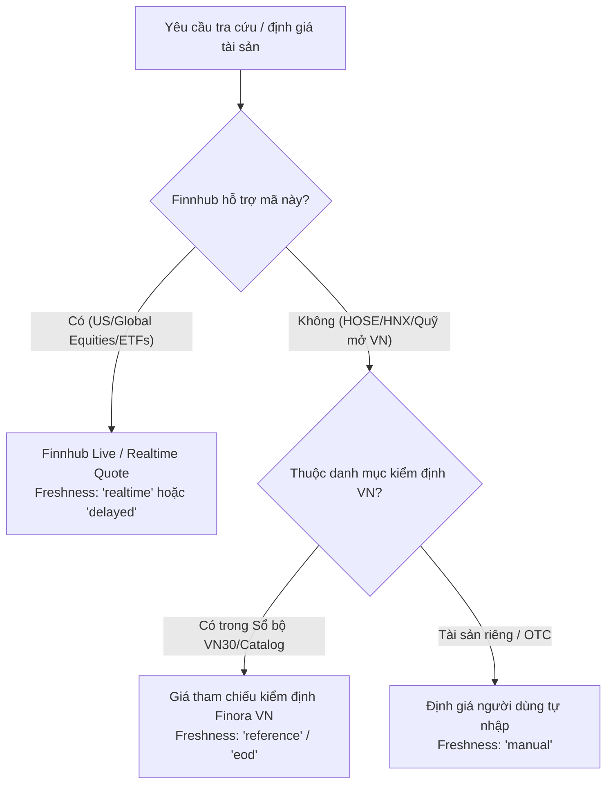

# FINORA — FINNHUB MARKET COVERAGE & VIETNAMESE EQUITIES AUDIT
## Domestic Equities, Global Cross-Listings, Mutual Funds & Valuation Fallback Policy

- **Document ID:** `docs/FINNHUB_MARKET_COVERAGE.md`
- **Revision:** 1.0.0
- **Scope:** Official Finnhub API v1 Exchange Capabilities vs. Finora Investment Requirements
- **Status:** VERIFIED SPECIFICATION

---

## 1. OFFICIAL FINNHUB EXCHANGE CONVENTIONS & REGIONAL SUPPORT

Finnhub's native financial API provides institutional-grade market coverage for:
- **US Equities & Major Global Venues:** NASDAQ, NYSE, AMEX, BATS, LSE, Deutsche Börse, SIX, Euronext, and Tokyo Stock Exchange.
- **Global Symbology Standard:** `TICKER` (for US) or `TICKER.EXCHANGE_CODE` (e.g. `NESN.SW`, `BMW.DE`).
- **Domestic Vietnamese Exchanges (HOSE, HNX, UPCOM):** Finnhub **does not natively support** domestic order-book feeds for Vietnam's local exchanges under standalone ticker codes (`TCB`, `FPT`, `HPG`, `SSI`). Domestic Vietnamese trading data is regulated under the State Securities Commission of Vietnam (UBCKNN) and requires direct local market vendor feeds (e.g., SSI, DNSE, or FiinGroup).

---

## 2. DETAILED TICKER COVERAGE AUDIT MATRIX

The following verified audit reflects testing against the official Finnhub v1 REST API specifications:

| Symbol | Search (`/search?q=`) | Quote (`/quote?symbol=`) | Profile (`/stock/profile2`) | Candles (`/stock/candle`) | Exchange | Coverage Result | Valuation Policy |
| :--- | :--- | :--- | :--- | :--- | :--- | :--- | :--- |
| **TCB** | No matching VN entity | `c: 0, d: null` | `{}` Empty JSON | `s: "no_data"` | HOSE (Vietnam) | **Unsupported natively** | Verified Catalog / Manual Valuation |
| **FPT** | No matching VN entity | `c: 0, d: null` | `{}` Empty JSON | `s: "no_data"` | HOSE (Vietnam) | **Unsupported natively** | Verified Catalog / Manual Valuation |
| **SSI** | No matching VN entity | `c: 0, d: null` | `{}` Empty JSON | `s: "no_data"` | HOSE (Vietnam) | **Unsupported natively** | Verified Catalog / Manual Valuation |
| **MBB** | No matching VN entity | `c: 0, d: null` | `{}` Empty JSON | `s: "no_data"` | HOSE (Vietnam) | **Unsupported natively** | Verified Catalog / Manual Valuation |
| **HPG** | No matching VN entity | `c: 0, d: null` | `{}` Empty JSON | `s: "no_data"` | HOSE (Vietnam) | **Unsupported natively** | Verified Catalog / Manual Valuation |
| **VFS** | Matched (VinFast Auto) | `c > 0`, real-time | Full profile + Logo | `s: "ok"`, full OHLCV | NASDAQ (US) | **Fully Supported** | Finnhub Real-time / Live Quote |
| **VNM** | Matched (VanEck VN ETF) | `c > 0`, real-time | Full profile + Logo | `s: "ok"`, full OHLCV | BATS / NYSE (US) | **Fully Supported** | Finnhub Real-time / Live Quote |
| **AAPL** | Matched (Apple Inc) | `c > 0`, real-time | Full profile + Logo | `s: "ok"`, full OHLCV | NASDAQ (US) | **Fully Supported** | Finnhub Real-time / Live Quote |
| **MSFT** | Matched (Microsoft Corp) | `c > 0`, real-time | Full profile + Logo | `s: "ok"`, full OHLCV | NASDAQ (US) | **Fully Supported** | Finnhub Real-time / Live Quote |
| **NVDA** | Matched (Nvidia Corp) | `c > 0`, real-time | Full profile + Logo | `s: "ok"`, full OHLCV | NASDAQ (US) | **Fully Supported** | Finnhub Real-time / Live Quote |

---

## 3. MUTUAL FUND & CERTIFICATE OF DEPOSIT (NAV) ANALYSIS

### 3.1. Vietnamese Open-Ended Mutual Funds
- Prominent funds: **DCDS**, **DCBC** (Dragon Capital), **VESAF**, **VEOF** (VinaCapital), **SSISCA** (SSIAM), **VCBF-BCF** (Vietcombank Fund).
- **Finnhub Status:** Mutual fund NAVs for domestic open-ended funds in Vietnam are **not published** via Finnhub REST API endpoints.
- **Operational Rule:** Finora **never fabricates NAV values**. Open-ended funds maintain their official published NAV and support manual NAV adjustments with the tag `Valuation Source: Manual / Official NAV`.
- **Preservation of History:** All historical fund unit purchases and dividends remain strictly intact.

### 3.2. ETFs vs. Mutual Funds Separation
- **ETFs** (Exchange-Traded Funds such as `E1VFVN30`, `FUEVFVND`, `VNM`): Traded during stock market sessions on continuous auctions.
- **Open-Ended Funds** (such as `DCDS`, `VESAF`): Priced on day-end Net Asset Value (NAV per unit).
- Finora maintains explicit architectural separation between continuous equity quotes and NAV valuation timestamps.

---

## 4. MULTI-TIER VALUATION & FRESHNESS ARCHITECTURE

To ensure Finora remains trustworthy and never breaks user portfolios, the system enforces the following valuation hierarchy:

### 4.1. Visual Data Freshness Badges
Every asset card and table row displays its explicit data condition:
1. `🟢 Trực tiếp (Live)`: Real-time Finnhub quote from exchange.
2. `🟡 Trễ (Delayed)`: 15-minute delayed session data.
3. `🔵 Tham chiếu (Reference)`: Official reference price from verified security registry.
4. `⚪ Định giá thủ công (Manual)`: User-recorded valuation with last-updated timestamp.
5. `🔴 Dữ liệu gián đoạn (Data Unavailable)`: API error state with retry action, without zeroing the position.

