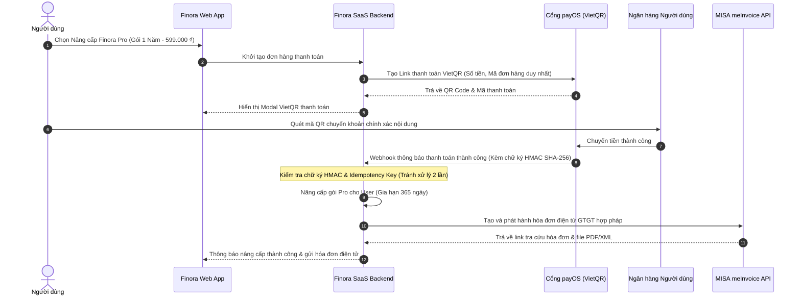

# FINORA — SEPARATE SAAS ADMINISTRATION PLATFORM ARCHITECTURE
## Privacy-First Admin Console, Business Revenue Accounting, E-Invoicing & Platform Health

- **Document ID:** `docs/FINORA_ADMIN_ARCHITECTURE.md`
- **Revision:** 2.0.0
- **Scope:** Ứng dụng Quản trị Nền tảng Doanh nghiệp Finora SaaS (`/admin/*`)

---

## 1. RANH GIỚI BẢO MẬT & QUYỀN RIÊNG TƯ TUYỆT ĐỐI (CRITICAL PRIVACY BOUNDARY)

Finora Admin được xây dựng để phục vụ việc **vận hành sản phẩm thương mại SaaS (Software-as-a-Service)** của Công ty Finora. Hệ thống này được phân tách vật lý và logic hoàn toàn khỏi ứng dụng tài chính cá nhân của người dùng cuối.

### Nguyên tắc Bất khả Xâm phạm (Zero-Access Privacy Guarantee):
Admin quản lý người dùng với tư cách là **khách hàng của phần mềm Finora**, **KHÔNG PHẢI là kế toán giám sát tiền bạc riêng của người dùng**:

| Hành động | Quyền hạn của Admin | Cơ chế Kiểm soát & Ngăn chặn |
| :--- | :---: | :--- |
| Xem Email, Tên hiển thị, Ngày đăng ký | **ĐƯỢC PHÉP** | Hiển thị trong bảng User Management |
| Xem Trạng thái Gói cước (Free, Pro), Ngày hết hạn | **ĐƯỢC PHÉP** | Quản lý vòng đời thuê bao SaaS |
| Xem Lịch sử thanh toán gói cước Finora Pro | **ĐƯỢC PHÉP** | Quản lý dòng tiền kinh doanh của Finora |
| Xem/Xuất Hóa đơn điện tử VAT gói Pro | **ĐƯỢC PHÉP** | Kê khai thuế doanh nghiệp Finora |
| **Xem Danh sách giao dịch chi tiêu của người dùng** | **TUYỆT ĐỐI CẤM** | Bị chặn ở tầng API Auth & DB Row-Level Security |
| **Xem Số dư tài khoản ngân hàng, ví MoMo của user** | **TUYỆT ĐỐI CẤM** | Dữ liệu mã hóa với Key riêng của từng User |
| **Xem Phiếu lương, Thu nhập, Thuế cá nhân của user** | **TUYỆT ĐỐI CẤM** | API trả về mã lỗi `403 Forbidden` |
| **Xem Danh mục cổ phiếu, quỹ, Stop Loss của user** | **TUYỆT ĐỐI CẤM** | Không có Endpoint quản trị cho dữ liệu này |
| **Sửa đổi số dư, giao dịch hoặc lệnh đầu tư** | **TUYỆT ĐỐI CẤM** | Thiết kế không có hàm cập nhật từ phía Admin |

---

## 2. KIẾN TRÚC ROUTING & PHÂN QUYỀN ADMIN

Ứng dụng Admin hoạt động dưới không gian định tuyến riêng biệt:
- `/admin/login`: Đăng nhập Quản trị viên (bắt buộc xác thực đa yếu tố 2FA/TOTP).
- `/admin/dashboard`: Bảng điều khiển kinh doanh cấp lãnh đạo (Executive Business Metrics).
- `/admin/users`: Quản lý danh sách tài khoản khách hàng, khóa/mở khóa tài khoản vi phạm.
- `/admin/subscriptions`: Quản lý danh sách người dùng Pro, lịch gia hạn cước.
- `/admin/plans`: Cấu hình giá các gói dịch vụ (Free, Premium, Pro), mã giảm giá (Vouchers).
- `/admin/payments`: Lịch sử giao dịch thanh toán qua cổng payOS, MoMo, đối soát tiền về tài khoản công ty.
- `/admin/revenue`: Doanh thu định kỳ (MRR, ARR), tỷ lệ rời bỏ (Churn Rate), giá trị trọn đời (LTV).
- `/admin/invoices`: Quản lý hóa đơn điện tử GTGT xuất cho khách hàng Pro (kết nối MISA meInvoice).
- `/admin/expenses`: Sổ chi phí hoạt động của công ty Finora (tiền thuê máy chủ AWS/Vercel, chi phí API đối tác, lương nhân sự).
- `/admin/system-health`: Giám sát hạ tầng kỹ thuật (API latency, Uptime, Database Pool, Cache Hit Rate).
- `/admin/integrations`: Quản trị trạng thái kết nối các nhà cung cấp dữ liệu thị trường (SSI, DNSE, Fmarket) và cổng thanh toán.
- `/admin/audit-logs`: Nhật ký kiểm toán không thể chỉnh sửa, ghi lại mọi thao tác của từng Quản trị viên.

---

## 3. BẢNG ĐIỀU KHIỂN KINH DOANH SAAS (EXECUTIVE BUSINESS METRICS)

Bảng điều khiển kinh doanh hiển thị các chỉ số tài chính của chính **Công ty Finora**:
1. **MRR (Monthly Recurring Revenue - Doanh thu Định kỳ Hàng tháng):**
   $$\text{MRR} = \sum (\text{Số lượng thuê bao Pro đang hoạt động} \times \text{Đơn giá gói tháng})$$
2. **ARR (Annual Recurring Revenue - Doanh thu Định kỳ Hàng năm):**
   $$\text{ARR} = \text{MRR} \times 12$$
3. **ARPU (Average Revenue Per User - Doanh thu trung bình trên mỗi khách hàng):**
   $$\text{ARPU} = \frac{\text{Tổng doanh thu gói cước}}{\text{Tổng số người dùng hoạt động (Active Users)}}$$
4. **Tỷ lệ Churn (Churn Rate - Tỷ lệ người dùng hủy gia hạn gói Pro):**
   $$\text{Churn Rate} = \frac{\text{Số thuê bao Pro hủy trong tháng}}{\text{Tổng thuê bao Pro đầu tháng}} \times 100\%$$
5. **Tỷ lệ chuyển đổi dùng thử sang trả phí (Trial-to-Paid Conversion Rate).**

---

## 4. TÍCH HỢP THANH TOÁN SAAS & HÓA ĐƠN ĐIỆN TỬ (MISA MEINVOICE)

### Nguyên tắc Xử lý Thanh toán An toàn (Payment Idempotency):
- Mọi Webhook từ cổng thanh toán (payOS, MoMo) bắt buộc phải kiểm tra **Chữ ký điện tử bí mật (Webhook Secret Signature)**.
- Áp dụng cơ chế **Idempotency**: Lưu mã giao dịch duy nhất (`transactionCode`). Nếu nhận được webhook trùng lặp do mạng lag, hệ thống chỉ trả về mã phản hồi `200 OK` mà không kích hoạt cộng dồn thời hạn gói Pro nhiều lần.

---

## 5. KẾ TOÁN TÀI CHÍNH NỘI BỘ DOANH NGHIỆP FINORA

Phân biệt rạch ròi giữa số tiền trong tài khoản của người dùng với **Báo cáo Tài chính của Doanh nghiệp Finora**:
- **Doanh thu Công ty (Revenue):** Phí bản quyền phần mềm gói Pro, phí dịch vụ API.
- **Chi phí Doanh nghiệp (Operating Expenses):**
  - Chi phí hạ tầng Cloud (Vercel, Supabase, Neon PostgreSQL, Upstash Redis).
  - Chi phí dữ liệu thị trường trả cho các nhà cung cấp (DNSE, SSI).
  - Chi phí bản quyền hóa đơn điện tử MISA meInvoice.
  - Chi phí cổng thanh toán (0.5% - 1.5% phí giao dịch).
  - Chi phí lương đội ngũ kỹ thuật và chi phí vận hành.
- **Báo cáo Lợi nhuận & Lỗ (P&L):** $\text{Lợi nhuận ròng} = \text{Doanh thu bản quyền} - \text{Chi phí hạ tầng \& vận hành} - \text{Thuế TNDN}$.

