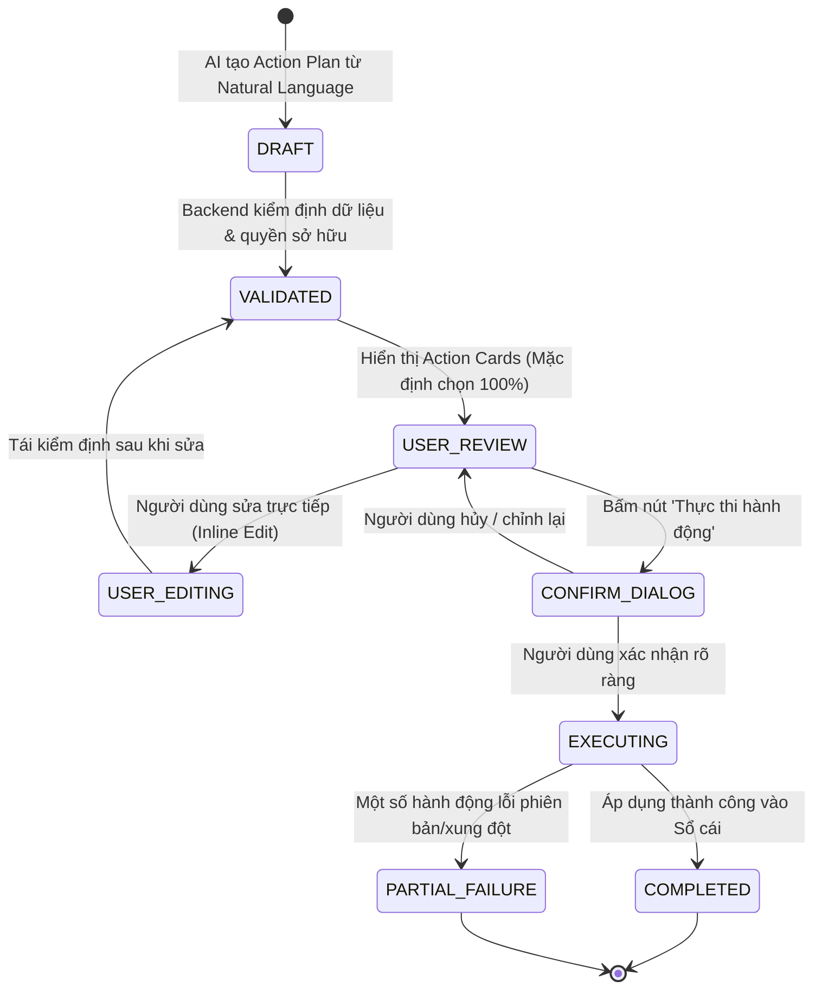

# FINORA AI — ACTION PROPOSAL & EXECUTION SYSTEM
## Draft Proposals, Multi-Item Default Selection, Inline Editing & Two-Phase Confirmation

- **Document ID:** `docs/FINORA_AI_ACTION_SYSTEM.md`
- **Revision:** 2.0.0
- **Mandate:** **No financial record is ever mutated without explicit user confirmation.**

---

## 1. ACTION PLAN LIFECYCLE & TWO-PHASE COMMIT

---

## 2. CRITICAL UI/UX SPECIFICATIONS

### 2.1. Default All-Selected Rule (Quy tắc Mặc định Chọn Tất Cả)
Whenever Finora AI proposes multiple actions (e.g. 3 transactions or 4 budget entries), **all valid actions must be checked/selected by default**.
- **Counter Badge:** Always displays `Đã chọn: X/Y hành động` (e.g. `Đã chọn: 3/3 hành động`).
- **Bulk Controls:** Provides `Chọn tất cả` (Select All) and `Bỏ chọn tất cả` (Deselect All) buttons.
- **Granular Checkboxes:** Users can uncheck individual items before executing.

### 2.2. Interactive Inline Action Cards
Each action card renders:
- **Badge Type:** `CREATE` (Xanh ngọc), `UPDATE` (Xanh dương), `DELETE` (Đỏ cảnh báo).
- **Entity Category & Logo:** Instantly recognizable avatar (Food, Rent, Techcombank, VCB...).
- **Inline Editable Fields:** Users can directly click and adjust the Amount, Category, or Date directly inside the card without typing another prompt.
- **Instant Re-Validation:** Modifying a field re-validates the draft action in real-time.

### 2.3. Safety Confirmation Dialog
Before committing any changes, a Modal dialog displays:
- Number of approved actions.
- Total cash flow impact (e.g. `Tổng chi: 2,500,000 ₫`).
- Affected accounts and categories.
- Irreversible warnings (for deletions or account balance adjustments).
- Explicit action button: `Xác nhận & Ghi vào Sổ cái`.
