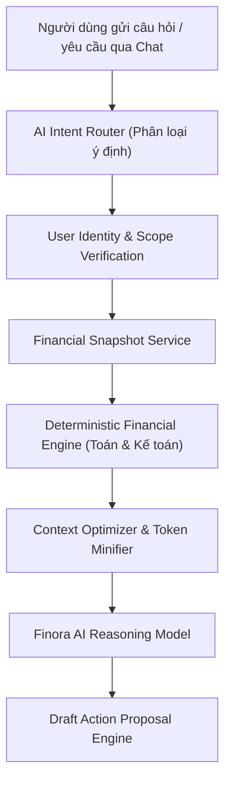

# FINORA AI — CONTEXT ARCHITECTURE SPECIFICATION
## Scoped Financial Data Retrieval, Snapshot Engine & Zero Cross-User Leakage

- **Document ID:** `docs/FINORA_AI_CONTEXT_ARCHITECTURE.md`
- **Revision:** 2.0.0
- **Scope:** Server-Side Context Aggregation, Security Boundary & Memory Model

---

## 1. ARCHITECTURAL DATA FLOW

Finora AI avoids the anti-pattern of dumping entire database tables into the LLM prompt. It implements a layered **Financial Context Engine** (`AIFinancialContextService`):

---

## 2. REUSABLE FINANCIAL SNAPSHOTS

To achieve microsecond response times and minimal token overhead, the server maintains structured memory snapshots with automated invalidation:

1. **`UserFinancialSnapshot`:** Net worth, total cash liquidity, monthly income baseline, burn rate.
2. **`MonthlyFinancialSnapshot`:** Total completed income, total completed expenses, current savings rate, daily safe-to-spend.
3. **`BudgetSnapshot`:** Active budgets, spent amount per category, overspending flags.
4. **`InvestmentSnapshot`:** Positions count, total cost basis, market valuation, unrealized P/L, hit SL/TP counters.
5. **`DebtSnapshot`:** Total owed, total lent, debts due within 30 days.

### Snapshot Invalidation Policy:
Snapshots are keyed by `userId` and invalidated automatically upon any mutation event (transaction created, budget modified, position traded). Cached snapshots have an explicit TTL (60s to 300s).

---

## 3. STRICT SECURITY & PRIVACY ENFORCEMENT

1. **No User ID from AI Prompts:** The authenticated user identity is extracted solely from the verified session/token. The AI cannot forge or query a different `userId`.
2. **Zero Admin Access to User Chat or Ledgers:** Admin console telemetry measures aggregate token counts and request frequencies; Admin **never receives access** to user financial contexts or conversation transcripts.
3. **Sensitive Credential Shield:** Bank credentials, SMS parser keys, and Finnhub API tokens are never injected into the context window.
