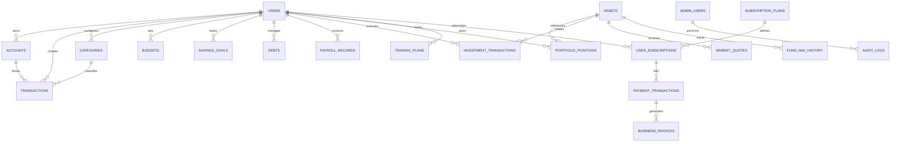

# FINORA — DATA MODEL & DATABASE SCHEMA SPECIFICATION
## Comprehensive Relational Schema for Personal Wealth, Multi-Asset Ledger & SaaS Operations

- **Document ID:** `docs/FINORA_DATA_MODEL.md`
- **Revision:** 2.0.0
- **Database Engine Target:** PostgreSQL 16+ / SQLite Local Storage Compatible
- **Monetary Unit Rule:** Số nguyên `BigInt` (Đơn vị Đồng — `VND`), không dùng kiểu `Float` để tránh sai số làm tròn tài chính.

---

## 1. SƠ ĐỒ QUAN HỆ THỰC THỂ TỔNG QUAN (ERD)



---

## 2. NHÓM THỰC THỂ TÀI CHÍNH CÁ NHÂN CỐT LÕI (PERSONAL FINANCE)

### 2.1. `users` (Người dùng cuối)
```sql
CREATE TABLE users (
    id VARCHAR(36) PRIMARY KEY,
    email VARCHAR(255) UNIQUE NOT NULL,
    full_name VARCHAR(150) NOT NULL,
    phone VARCHAR(20),
    avatar_url TEXT,
    currency VARCHAR(3) DEFAULT 'VND',
    financial_month_start INT DEFAULT 1 CHECK (financial_month_start BETWEEN 1 AND 28),
    created_at TIMESTAMP WITH TIME ZONE DEFAULT CURRENT_TIMESTAMP,
    updated_at TIMESTAMP WITH TIME ZONE DEFAULT CURRENT_TIMESTAMP
);
```

### 2.2. `accounts` (Tài khoản thanh toán, ví, tiết kiệm)
```sql
CREATE TABLE accounts (
    id VARCHAR(36) PRIMARY KEY,
    user_id VARCHAR(36) NOT NULL REFERENCES users(id) ON DELETE CASCADE,
    name VARCHAR(100) NOT NULL,
    type VARCHAR(20) NOT NULL CHECK (type IN ('cash', 'bank', 'credit', 'savings', 'e-wallet', 'investment')),
    initial_balance BIGINT DEFAULT 0,
    currency VARCHAR(3) DEFAULT 'VND',
    color VARCHAR(20),
    icon VARCHAR(50),
    is_active BOOLEAN DEFAULT TRUE,
    created_at TIMESTAMP WITH TIME ZONE DEFAULT CURRENT_TIMESTAMP
);
CREATE INDEX idx_accounts_user ON accounts(user_id);
```

### 2.3. `transactions` (Giao dịch thu/chi/chuyển khoản cá nhân)
```sql
CREATE TABLE transactions (
    id VARCHAR(36) PRIMARY KEY,
    user_id VARCHAR(36) NOT NULL REFERENCES users(id) ON DELETE CASCADE,
    account_id VARCHAR(36) NOT NULL REFERENCES accounts(id),
    to_account_id VARCHAR(36) REFERENCES accounts(id),
    category_id VARCHAR(36) REFERENCES categories(id),
    type VARCHAR(20) NOT NULL CHECK (type IN ('income', 'expense', 'transfer')),
    amount BIGINT NOT NULL CHECK (amount > 0),
    name VARCHAR(255) NOT NULL,
    date DATE NOT NULL,
    method VARCHAR(50),
    status VARCHAR(20) DEFAULT 'completed' CHECK (status IN ('completed', 'pending', 'cancelled')),
    note TEXT,
    receipt_url TEXT,
    created_at TIMESTAMP WITH TIME ZONE DEFAULT CURRENT_TIMESTAMP
);
CREATE INDEX idx_transactions_user_date ON transactions(user_id, date DESC);
```

---

## 3. NHÓM THỰC THỂ LƯƠNG & THUẾ ĐỘNG (PAYROLL & TAX)

### 3.1. `payroll_records` (Bảng lương tháng)
```sql
CREATE TABLE payroll_records (
    id VARCHAR(36) PRIMARY KEY,
    user_id VARCHAR(36) NOT NULL REFERENCES users(id) ON DELETE CASCADE,
    month VARCHAR(7) NOT NULL, -- Định dạng YYYY-MM
    contract_salary BIGINT NOT NULL,
    is_probation BOOLEAN DEFAULT FALSE,
    probation_rate NUMERIC(4, 2) DEFAULT 0.85,
    base_salary_insurance BIGINT NOT NULL,
    standard_work_days INT DEFAULT 22,
    actual_work_days NUMERIC(4, 1) NOT NULL,
    paid_leave_days NUMERIC(4, 1) DEFAULT 0,
    unpaid_leave_days NUMERIC(4, 1) DEFAULT 0,
    overtime_weekday_hours NUMERIC(5, 1) DEFAULT 0,
    overtime_weekend_hours NUMERIC(5, 1) DEFAULT 0,
    overtime_holiday_hours NUMERIC(5, 1) DEFAULT 0,
    overtime_pay_total BIGINT DEFAULT 0,
    taxable_allowances BIGINT DEFAULT 0,
    non_taxable_allowances BIGINT DEFAULT 0,
    performance_bonus BIGINT DEFAULT 0,
    sales_commission BIGINT DEFAULT 0,
    gross_income BIGINT NOT NULL,
    social_insurance_employee BIGINT DEFAULT 0,
    health_insurance_employee BIGINT DEFAULT 0,
    unemployment_insurance_employee BIGINT DEFAULT 0,
    total_insurance_employee BIGINT DEFAULT 0,
    personal_deduction BIGINT DEFAULT 11000000,
    dependent_count INT DEFAULT 0,
    dependent_deduction_total BIGINT DEFAULT 0,
    taxable_income BIGINT DEFAULT 0,
    pit_withheld BIGINT DEFAULT 0,
    net_salary BIGINT NOT NULL,
    actual_paid_date DATE,
    status VARCHAR(20) DEFAULT 'draft' CHECK (status IN ('draft', 'verified', 'paid', 'unpaid')),
    created_at TIMESTAMP WITH TIME ZONE DEFAULT CURRENT_TIMESTAMP,
    UNIQUE (user_id, month)
);
```

---

## 4. NHÓM THỰC THỂ ĐẦU TƯ ĐA TÀI SẢN (INVESTMENT ECOSYSTEM)

### 4.1. `assets` (Danh mục tài sản chuẩn hóa toàn hệ thống)
```sql
CREATE TABLE assets (
    id VARCHAR(36) PRIMARY KEY,
    symbol VARCHAR(30) UNIQUE NOT NULL,     -- TCB, DCDS, VESAF, SJC...
    name VARCHAR(255) NOT NULL,            -- Ngân hàng TMCP Kỹ Thương Việt Nam
    asset_class VARCHAR(20) NOT NULL CHECK (asset_class IN ('stock', 'fund', 'etf', 'bond', 'gold', 'deposit', 'custom')),
    exchange VARCHAR(20),                  -- HOSE, HNX, UPCOM, OTC
    issuer VARCHAR(255),                   -- Techcombank, Dragon Capital, VinaCapital...
    logo_url TEXT,
    currency VARCHAR(3) DEFAULT 'VND',
    status VARCHAR(20) DEFAULT 'active' CHECK (status IN ('active', 'delisted', 'suspended')),
    created_at TIMESTAMP WITH TIME ZONE DEFAULT CURRENT_TIMESTAMP
);
CREATE INDEX idx_assets_symbol ON assets(symbol);
```

### 4.2. `investment_transactions` (Sổ cái giao dịch đầu tư của từng người dùng)
```sql
CREATE TABLE investment_transactions (
    id VARCHAR(36) PRIMARY KEY,
    user_id VARCHAR(36) NOT NULL REFERENCES users(id) ON DELETE CASCADE,
    asset_id VARCHAR(36) NOT NULL REFERENCES assets(id),
    account_id VARCHAR(36) REFERENCES accounts(id),
    tx_type VARCHAR(20) NOT NULL CHECK (tx_type IN ('BUY', 'SELL', 'DEPOSIT_FUND', 'REDEEM_FUND', 'DIVIDEND_CASH', 'DIVIDEND_STOCK', 'RIGHTS', 'COUPON', 'MATURITY', 'SPLIT', 'ADJUSTMENT')),
    quantity NUMERIC(15, 4) NOT NULL,     -- Số lượng cổ phiếu/CCQ (hỗ trợ quỹ có số lẻ 4 chữ số)
    unit_price BIGINT NOT NULL,           -- Đơn giá khớp lệnh (₫)
    gross_amount BIGINT NOT NULL,         -- quantity * unit_price
    trading_fee BIGINT DEFAULT 0,         -- Phí giao dịch
    tax_amount BIGINT DEFAULT 0,          -- Thuế bán 0.1% hoặc thuế cổ tức 5%
    net_cash_movement BIGINT NOT NULL,    -- Tiền mặt ròng tăng hoặc giảm
    trade_date DATE NOT NULL,
    settlement_date DATE,                 -- Ngày thanh toán (T+2 đối với cổ phiếu Việt Nam)
    note TEXT,
    created_at TIMESTAMP WITH TIME ZONE DEFAULT CURRENT_TIMESTAMP
);
CREATE INDEX idx_inv_tx_user_asset ON investment_transactions(user_id, asset_id, trade_date DESC);
```

### 4.3. `trading_plans` (Kế hoạch Cắt lỗ & Chốt lời SL/TP)
```sql
CREATE TABLE trading_plans (
    id VARCHAR(36) PRIMARY KEY,
    user_id VARCHAR(36) NOT NULL REFERENCES users(id) ON DELETE CASCADE,
    asset_id VARCHAR(36) NOT NULL REFERENCES assets(id),
    target_entry_price BIGINT NOT NULL,
    planned_quantity NUMERIC(15, 4) NOT NULL,
    stop_loss_price BIGINT NOT NULL,
    take_profit_price BIGINT NOT NULL,
    max_risk_amount BIGINT NOT NULL,      -- Khoản tiền tối đa chấp nhận mất tại SL
    potential_gain_amount BIGINT NOT NULL,-- Khoản tiền lãi kỳ vọng tại TP
    risk_reward_ratio NUMERIC(5, 2) NOT NULL, -- TP / SL
    execution_mode VARCHAR(10) NOT NULL CHECK (execution_mode IN ('MODE_A', 'MODE_B', 'MODE_C')),
    status VARCHAR(20) DEFAULT 'active' CHECK (status IN ('active', 'triggered_sl', 'triggered_tp', 'closed', 'cancelled')),
    investment_thesis TEXT,               -- Lý do vào lệnh (Trading Journal)
    created_at TIMESTAMP WITH TIME ZONE DEFAULT CURRENT_TIMESTAMP
);
```

---

## 5. NHÓM THỰC THỂ QUẢN TRỊ DOANH NGHIỆP SAAS (FINORA ADMIN)

### 5.1. `subscription_plans` (Các gói cước phần mềm)
```sql
CREATE TABLE subscription_plans (
    id VARCHAR(36) PRIMARY KEY,
    code VARCHAR(50) UNIQUE NOT NULL,     -- free, pro_monthly, pro_yearly, lifetime
    name VARCHAR(100) NOT NULL,
    description TEXT,
    price_monthly BIGINT DEFAULT 0,
    price_yearly BIGINT DEFAULT 0,
    trial_days INT DEFAULT 0,
    feature_flags JSONB NOT NULL,         -- {"unlimitedAccounts": true, "realtimeQuotes": true, "multiPeriodReports": true}
    is_active BOOLEAN DEFAULT TRUE,
    created_at TIMESTAMP WITH TIME ZONE DEFAULT CURRENT_TIMESTAMP
);
```

### 5.2. `payment_transactions` (Lịch sử thanh toán gói cước của người dùng)
```sql
CREATE TABLE payment_transactions (
    id VARCHAR(36) PRIMARY KEY,
    user_id VARCHAR(36) NOT NULL REFERENCES users(id),
    plan_id VARCHAR(36) NOT NULL REFERENCES subscription_plans(id),
    gateway VARCHAR(30) NOT NULL CHECK (gateway IN ('payos', 'momo', 'vnpay', 'manual_bank')),
    gateway_order_code VARCHAR(100) UNIQUE NOT NULL,
    gateway_transaction_no VARCHAR(100),
    amount BIGINT NOT NULL,
    currency VARCHAR(3) DEFAULT 'VND',
    status VARCHAR(20) NOT NULL CHECK (status IN ('pending', 'completed', 'failed', 'refunded')),
    paid_at TIMESTAMP WITH TIME ZONE,
    idempotency_key VARCHAR(100) UNIQUE NOT NULL,
    webhook_payload JSONB,
    created_at TIMESTAMP WITH TIME ZONE DEFAULT CURRENT_TIMESTAMP
);
CREATE INDEX idx_payment_status ON payment_transactions(status, paid_at DESC);
```

### 5.3. `business_invoices` (Hóa đơn điện tử VAT của công ty Finora)
```sql
CREATE TABLE business_invoices (
    id VARCHAR(36) PRIMARY KEY,
    payment_id VARCHAR(36) NOT NULL REFERENCES payment_transactions(id),
    invoice_number VARCHAR(50),           -- Ký hiệu & Số hóa đơn (VD: 1C26TAA-000123)
    provider VARCHAR(50) DEFAULT 'misa',  -- Nhà cung cấp MISA meInvoice
    buyer_name VARCHAR(150) NOT NULL,
    buyer_tax_code VARCHAR(30),
    buyer_address TEXT,
    buyer_email VARCHAR(255) NOT NULL,
    total_without_tax BIGINT NOT NULL,
    vat_rate NUMERIC(4, 2) DEFAULT 0.10,  -- Thuế suất GTGT 10%
    vat_amount BIGINT NOT NULL,
    total_with_tax BIGINT NOT NULL,
    status VARCHAR(30) DEFAULT 'draft' CHECK (status IN ('draft', 'issued', 'cancelled', 'replaced')),
    invoice_pdf_url TEXT,
    invoice_xml_url TEXT,
    issued_at TIMESTAMP WITH TIME ZONE
);
```

### 5.4. `audit_logs` (Nhật ký kiểm toán không thể xóa/sửa)
```sql
CREATE TABLE audit_logs (
    id VARCHAR(36) PRIMARY KEY,
    admin_id VARCHAR(36) NOT NULL,
    admin_email VARCHAR(255) NOT NULL,
    action VARCHAR(100) NOT NULL,
    resource_type VARCHAR(50) NOT NULL,
    resource_id VARCHAR(100) NOT NULL,
    ip_address VARCHAR(45) NOT NULL,
    user_agent TEXT,
    previous_state JSONB,
    new_state JSONB,
    created_at TIMESTAMP WITH TIME ZONE DEFAULT CURRENT_TIMESTAMP NOT NULL
);
CREATE INDEX idx_audit_logs_action ON audit_logs(action, created_at DESC);
```

