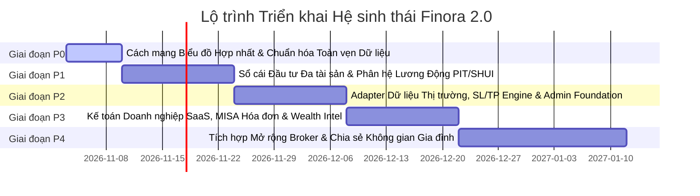

# FINORA — TECHNICAL IMPLEMENTATION ROADMAP
## Phased Architecture Milestones, Release Plan & Quality Assurance Gates

- **Document ID:** `docs/FINORA_IMPLEMENTATION_ROADMAP.md`
- **Revision:** 2.0.0
- **Execution Methodology:** Phased Agile Delivery with Zero-Regression Financial Verification

---

## 1. NGUYÊN TẮC ƯU TIÊN HÀNG ĐẦU (CORE PRINCIPLES)

1. **Dữ liệu thực tế quan trọng hơn dữ liệu giả lập (Real Data over Fabricated Data).**
2. **Tính toán tài chính chính xác quan trọng hơn đồ thị trang trí (Correct Calculations over Decorative Dashboards).**
3. **Quyền riêng tư của khách hàng quan trọng hơn sự tiện lợi của Admin (User Privacy over Admin Convenience).**
4. **Tự động hóa có ý nghĩa thực tế quan trọng hơn tính năng AI phô trương (Meaningful Automation over Fake AI).**
5. **Thiết kế Mobile-First tối ưu trải nghiệm chạm thực tế (Mobile-First Usability over Desktop-Only).**

---

## 2. LỘ TRÌNH TRIỂN KHAI THEO CÁC GIAI ĐOẠN (P0 $\rightarrow$ P4)

---

### GIAI ĐOẠN P0: CÁCH MẠNG BIỂU ĐỒ HỢP NHẤT & CHUẨN HÓA NỀN TẢNG (HIỆN TẠI)
- **Mục tiêu:**
  - Giải quyết dứt điểm phản hồi của người dùng: Xóa bỏ hoàn toàn tình trạng biểu đồ rời rạc, nghèo nàn, màu sắc swamp-green đục ngầu.
  - Tích hợp **Biểu đồ Tài chính Hợp nhất (Unified Composed Financial Chart)**: Cột đôi Thu/Chi kết hợp đường cong Spline **Dòng tiền ròng (Net Cashflow Surplus/Deficit)** và quỹ đạo **Tài sản ròng (Net Worth Trajectory)** trên cùng một khung trực quan sinh động.
  - Thêm bộ chọn Metric tương tác (`[✓ Thu vào]`, `[✓ Chi ra]`, `[✓ Dòng tiền ròng]`), Tooltip tùy biến chuẩn Fintech hiển thị tỷ lệ tiết kiệm theo ngày, và Thẻ Obsidian bề mặt phẳng chuẩn Linear.
  - Hoàn thiện trọn bộ 8 tài liệu đặc tả kiến trúc trong thư mục `docs/`.
- **Cổng nghiệm thu (QA Gate):** 100% test suite Vitest (37/37 tests) vượt qua; `pnpm build` không lỗi TypeScript.

---

### GIAI ĐOẠN P1: DANH MỤC ĐẦU TƯ ĐA TÀI SẢN & PHÂN HỆ LƯƠNG ĐỘNG
- **Phân hệ Đầu tư:**
  - Xây dựng danh mục chuẩn hóa (`assets` catalog): Cổ phiếu, Quỹ mở, ETF, Vàng, Tiền gửi tiết kiệm.
  - Triển khai Sổ cái Giao dịch Đầu tư 12 loại nghiệp vụ kế toán (`BUY`, `SELL`, `DEPOSIT_FUND`, `REDEEM_FUND`, `DIVIDEND_CASH`, `DIVIDEND_STOCK`...).
  - Động cơ tính Giá vốn Bình quân Gia quyền (Weighted Average Cost Basis) và Lãi/Lỗ đã chốt / chưa chốt.
- **Phân hệ Lương động & Thuế:**
  - Bảng lương tháng linh hoạt (`payroll_records`): Hỗ trợ lương thử việc 85%, biến động ngày công thực tế, làm thêm giờ (OT 150%, 200%, 300%), các khoản phụ cấp và thưởng.
  - Bộ động cơ tính trích trừ bảo hiểm bắt buộc người lao động 10.5% (BHXH 8%, BHYT 1.5%, BHTN 1%) có khống chế mức trần tối đa.
  - Bộ động cơ tính Thuế TNCN lũy tiến từng phần 7 bậc tự động phân tách phần OT miễn thuế và giảm trừ gia cảnh.
- **Cổng nghiệm thu:** Kiểm thử unit test các trường hợp biên lương tháng bằng 0, lương thử việc, và quyết toán thuế năm.

---

### GIAI ĐOẠN P2: KẾT NỐI DỮ LIỆU THỊ TRƯỜNG, ĐỘNG CƠ SL/TP & ADMIN NỀN TẢNG
- **Dữ liệu Thị trường:**
  - Triển khai kiến trúc `MarketDataProvider` với cơ chế Cache 10s, Exponential Backoff và Stale Data Detection.
  - Tích hợp giá tham chiếu Cổ phiếu (DNSE/SSI) và lịch công bố NAV Quỹ mở (Fmarket/Dragon Capital/VinaCapital).
- **Động cơ Cắt lỗ & Chốt lời (SL/TP Engine):**
  - Chế độ A: Theo dõi rủi ro cá nhân (Visual Risk Gauge, Risk/Reward Ratio).
  - Chế độ B: Cảnh báo giá thông minh qua trình duyệt khi tiệm cận ngưỡng.
  - Nhật ký giao dịch (Trading Journal) ghi nhận bài học kinh nghiệm và tâm lý đầu tư.
- **Finora Admin Foundation:**
  - Thiết lập không gian định tuyến riêng biệt `/admin/*` có xác thực 2FA TOTP bắt buộc.
  - Thiết lập ranh giới bảo mật Row-Level Security: Admin **KHÔNG CÓ QUYỀN** xem dữ liệu giao dịch chi tiêu riêng của user.
  - Bảng điều khiển kinh doanh SaaS (MRR, ARR, Churn Rate, Active Users).
  - Tích hợp cổng thanh toán payOS VietQR tự động nâng cấp gói Pro.

---

### GIAI ĐOẠN P3: KẾ TOÁN DOANH NGHIỆP SAAS, HÓA ĐƠN MISA & TRÍ TUỆ TÀI CHÍNH
- **Kế toán Doanh nghiệp SaaS:**
  - Sổ theo dõi doanh thu gói Pro và chi phí máy chủ, chi phí API đối tác của công ty Finora.
  - Tích hợp phát hành Hóa đơn điện tử GTGT hợp pháp qua MISA meInvoice REST API khi thanh toán thành công.
- **Trí tuệ Tài chính Cá nhân (Wealth Intelligence):**
  - Chỉ số Sức khỏe Tài chính (Financial Health Score 0–100 điểm) có lý giải công thức.
  - Chỉ số Chi tiêu An toàn (Safe-to-Spend) từ nay đến kỳ lương tiếp theo.
  - Dự báo Dòng tiền 30/90 ngày (Cashflow Forecasting) theo 3 kịch bản: Tốt nhất, Cơ sở, và Thận trọng.
  - Bộ lập kế hoạch Quỹ khẩn cấp 6 tháng chi phí thiết yếu.

---

### GIAI ĐOẠN P4: TỰ ĐỘNG HÓA NÂNG CAO & KHÔNG GIAN TÀI CHÍNH GIA ĐÌNH
- **Tự động hóa Chứng khoán (Strict Mode C):**
  - Luồng kết nối OAuth2 có mã hóa PKCE tới công ty chứng khoán được chứng nhận.
  - Đặt lệnh điều kiện Stop-Limit / OCO với xác nhận kép và chữ ký số OTP của người dùng.
- **Không gian Gia đình (Household Spaces):**
  - Ngân sách dùng chung cho vợ chồng hoặc nhóm gia đình với phân quyền rõ ràng, bảo vệ các khoản chi tiêu cá nhân riêng tư.

---

## 3. MA TRẬN QUẢN TRỊ RỦI RO & PHƯƠNG ÁN DỰ PHÒNG

| Rủi ro kỹ thuật / Nghiệp vụ | Mức độ | Phương án Kiểm soát & Dự phòng của Finora |
| :--- | :---: | :--- |
| **API dữ liệu thị trường bị gián đoạn hoặc quá tải** | Cao | Lớp Cache đệm tự động; Gắn nhãn `Delayed` / `Stale Data` minh bạch; Cơ chế Fallback về bản ghi EOD gần nhất |
| **Lỗi làm tròn tiền tệ hoặc phân kỳ kế toán** | Nghiêm trọng | Lưu trữ đơn vị `BigInt` (Đồng nguyên); 37 tests bảo toàn số dư chạy tự động trên CI/CD |
| **Admin vô tình truy cập dữ liệu nhạy cảm của khách** | Nghiêm trọng | Ngăn chặn ở cấp độ Database Row-Level Security & Middleware; Không xây dựng API endpoint đọc chi tiết |
| **Webhook thanh toán bị gửi lặp lại gây lỗi gia hạn** | Trung bình | Kiểm tra chữ ký HMAC SHA-256 bắt buộc; Sử dụng `Idempotency-Key` ghi nhận duy nhất 1 lần |
| **Quy định thuế TNCN hoặc mức đóng bảo hiểm thay đổi** | Trung bình | Động cơ thuế `TaxRuleConfig` có phiên bản hóa theo ngày hiệu lực, không hardcode số liệu cũ |

