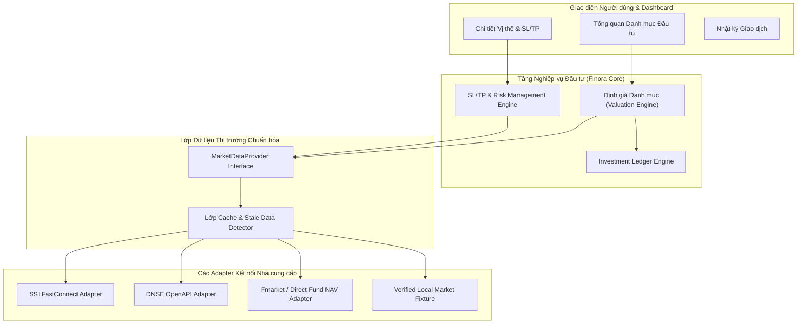

# FINORA — INVESTMENT MANAGEMENT ARCHITECTURE SPECIFICATION
## Multi-Asset Portfolio Engine, Provider-Agnostic Market Data Layer & SL/TP Execution System

- **Document ID:** `docs/FINORA_INVESTMENT_ARCHITECTURE.md`
- **Revision:** 2.0.0
- **Layer:** Core Investment Engine & Financial Data Architecture

---

## 1. TỔNG QUAN KIẾN TRÚC ĐẦU TƯ

Phân hệ Đầu tư Finora được thiết kế theo mô hình **Sổ cái Giao dịch Kế toán (Transaction-Based Ledger)** kết hợp với **Lớp Dữ liệu Thị trường Độc lập (Provider-Agnostic Market Data Layer)**, đảm bảo:
- Không bao giờ lưu trữ số dư đầu tư chết; toàn bộ vị thế danh mục (Position), giá vốn bình quân (Cost Basis), lãi/lỗ chưa thực hiện (Unrealized P/L) và lãi/lỗ đã chốt (Realized P/L) đều được tính toán từ dòng giao dịch lịch sử.
- Phân biệt minh bạch giữa biến động dòng tiền nộp/rút vốn (Cash Inflow/Outflow) và hiệu suất đầu tư thực thụ (Time-Weighted Return - TWR).

---

## 2. CẤU TRÚC LỚP DỮ LIỆU THỊ TRƯỜNG (MARKET DATA LAYER)



### 2.1. Định nghĩa Interface Chuẩn hóa (`MarketDataProvider`)

```typescript
export type AssetClass =
  | 'stock'        // Cổ phiếu niêm yết
  | 'fund'         // Chứng chỉ quỹ mở
  | 'etf'          // Quỹ hoán đổi danh mục
  | 'bond'         // Trái phiếu doanh nghiệp / chính phủ
  | 'gold'         // Vàng miếng SJC / Vàng nhẫn 9999
  | 'deposit'      // Tiền gửi tiết kiệm ngân hàng
  | 'custom';      // Tài sản tự định giá

export type DataFreshness = 'realtime' | 'delayed' | 'eod' | 'nav_published' | 'manual';

export interface MarketQuote {
  assetId: string;
  symbol: string;
  lastPrice: number;            // Giá thị trường hiện tại (₫)
  previousClose: number;        // Giá đóng cửa phiên trước (₫)
  change: number;               // Chênh lệch tuyệt đối
  changePercent: number;        // Tỷ lệ biến động (%)
  high?: number;
  low?: number;
  volume?: number;
  nav?: number;                 // Áp dụng cho Quỹ mở
  navDate?: string;             // Ngày định giá NAV (YYYY-MM-DD)
  currency: 'VND';
  freshness: DataFreshness;
  marketTimestamp: string;      // Thời điểm khớp lệnh thực tế
  fetchedAt: string;            // Thời điểm Finora ghi nhận
  source: string;               // Tên nhà cung cấp (SSI, DNSE, Fmarket...)
}

export interface MarketDataProvider {
  getQuote(symbol: string, assetClass: AssetClass): Promise<MarketQuote>;
  getBatchQuotes(symbols: string[]): Promise<Record<string, MarketQuote>>;
  getHistory(symbol: string, from: string, to: string): Promise<Array<{ date: string; close: number; volume?: number }>>;
  searchCatalog(query: string, assetClass?: AssetClass): Promise<AssetCatalogItem[]>;
}
```

---

## 3. SỔ CÁI GIAO DỊCH ĐẦU TƯ (INVESTMENT TRANSACTION LEDGER)

Hệ thống hỗ trợ 12 loại nghiệp vụ đầu tư chuẩn mực:
1. **`BUY` (Mua tài sản):** Tăng số lượng nắm giữ, ghi nhận giá vốn, trừ tiền mặt hoặc ghi nhận nguồn vốn đối ứng.
2. **`SELL` (Bán tài sản):** Giảm số lượng nắm giữ, tính lãi/lỗ đã thực hiện (Realized P/L), ghi nhận thuế bán (0.1% giá trị chuyển nhượng theo luật thuế Việt Nam) và phí giao dịch công ty chứng khoán.
3. **`DEPOSIT_FUND` (Mua chứng chỉ quỹ mở):** Ghi nhận số tiền nộp, phí mua quỹ (Subscription fee) và số lượng CCQ được khớp theo NAV ngày định giá.
4. **`REDEEM_FUND` (Bán/Mua lại CCQ):** Ghi nhận tiền về sau khi trừ phí bán quỹ (Redemption fee) theo thời gian nắm giữ và thuế TNCN.
5. **`DIVIDEND_CASH` (Cổ tức tiền mặt):** Tăng tiền mặt khả dụng, trừ thuế TNCN khấu trừ tại nguồn 5% theo luật Việt Nam.
6. **`DIVIDEND_STOCK` (Cổ tức cổ phiếu):** Tăng số lượng cổ phiếu mà không làm thay đổi tổng giá vốn của lô cổ phiếu gốc (giá vốn bình quân tự động điều chỉnh giảm tương ứng).
7. **`RIGHTS_ISSUE` (Quyền mua ưu đãi):** Ghi nhận quyền và nộp tiền thực hiện quyền mua cổ phiếu phát hành thêm.
8. **`BOND_COUPON` (Lãi trái phiếu định kỳ):** Ghi nhận dòng thu nhập lãi trái phiếu.
9. **`MATURITY` (Đáo hạn gốc trái phiếu/tiền gửi):** Tất toán khoản gốc về tài khoản tiền mặt.
10. **`STOCK_SPLIT` (Chia tách cổ phiếu):** Điều chỉnh hệ số tỷ lệ chia tách tự động.
11. **`TRANSFER_ACCOUNT` (Chuyển khoản nội bộ giữa các tiểu khoản chứng khoán/ngân hàng).**
12. **`ADJUSTMENT` (Điều chỉnh số dư kiểm kê).**

### Công thức tính Giá vốn Bình quân Gia quyền (Weighted Average Cost):
$$\text{Giá vốn bình quân mới} = \frac{(\text{Số lượng hiện có} \times \text{Giá vốn cũ}) + (\text{Số lượng mua mới} \times \text{Giá khớp}) + \text{Phí mua}}{\text{Tổng số lượng sau mua}}$$

---

## 4. ĐỘNG CƠ CẮT LỖ & CHỐT LỜI (SL/TP ENGINE)

Khi người dùng mở một vị thế hoặc lập kế hoạch giao dịch (Trading Plan), Finora tính toán ngay lập tức các chỉ số rủi ro:
1. **Giá trị vị thế (Position Value):** Số lượng $\times$ Giá mua dự kiến.
2. **Ước tính Rủi ro Tối đa (Max Risk at Stop Loss):**
   $$\text{Khoản lỗ tại SL} = \text{Số lượng} \times (\text{Giá vào} - \text{Giá cắt lỗ}) + \text{Phí mua} + \text{Phí bán dự kiến} + \text{Thuế bán 0.1\%}$$
3. **Ước tính Lợi nhuận Kỳ vọng (Potential Gain at Take Profit):**
   $$\text{Khoản lãi tại TP} = \text{Số lượng} \times (\text{Giá chốt lời} - \text{Giá vào}) - \text{Phí mua} - \text{Phí bán dự kiến} - \text{Thuế bán 0.1\%}$$
4. **Tỷ lệ Lợi nhuận / Rủi ro (Risk / Reward Ratio):**
   $$\text{R/R Ratio} = \frac{\text{Khoản lãi tại TP}}{\text{Khoản lỗ tại SL}}$$
   - Finora khuyến nghị ngưỡng an toàn fintech tối thiểu: $R/R \ge 1:2$.

### 3 Chế độ Thực thi Độc lập:
- **MODE A — Theo dõi cá nhân (Tracking Only):** Lưu các mốc SL/TP trong cơ sở dữ liệu nội bộ. Hiển thị thanh tiến trình trực quan (Visual Risk Gauge) trên thẻ vị thế. Không gửi bất kỳ request nào ra ngoài.
- **MODE B — Cảnh báo thông minh (Smart Price Alerts):** Hệ thống giám sát luồng giá thị trường (`MarketQuote`). Khi giá chạm hoặc thủng ngưỡng SL/TP, kích hoạt Web Notification / Mobile Push Alert: *"Cảnh báo: TCB đã chạm ngưỡng Chốt lời 24,500 ₫ (Mục tiêu +22.5%)"*.
- **MODE C — Lệnh điều kiện công ty chứng khoán (Broker Conditional Orders):**
  - **Quy tắc An ninh Bất khả kháng:** Không bao giờ giả mạo việc đã đặt lệnh lên sàn.
  - Chỉ kích hoạt khi người dùng chủ động kết nối tài khoản chứng khoán được chứng nhận (DNSE / SSI OpenAPI) qua luồng OAuth2 có mã hóa PKCE.
  - Mọi lệnh gửi lên hệ thống giao dịch của CTCK bắt buộc phải có bước xác nhận rõ ràng của người dùng (User Confirmation Dialog) hiển thị đầy đủ: Mã, Số lượng, Loại lệnh (Stop-Limit / OCO), Giá kích hoạt, Phí ước tính và yêu cầu xác thực OTP/Sinh trắc học.
  - Lưu mã định danh lệnh CTCK (`brokerOrderId`) để đối chiếu trạng thái khớp/hủy tự động.

---

## 5. NHẬT KÝ GIAO DỊCH & QUẢN TRỊ RỦI RO (TRADING JOURNAL)

Finora tích hợp sẵn Trading Journal giúp nhà đầu tư rèn luyện kỷ luật tài chính:
- **Lý do giải ngân (Entry Thesis):** Phân tích kỹ thuật (Breakout, MA20 pullback), Phân tích cơ bản (KQKD Quý tăng trưởng, P/E hấp dẫn), hoặc Tích sản định kỳ (DCA).
- **Kỷ luật giao dịch:** So sánh giá vào lệnh dự kiến vs giá thực tế khớp lệnh (Slippage check).
- **Hậu kiểm sau khi đóng vị thế (Post-Mortem Review):** Ghi nhận bài học kinh nghiệm, sai lầm tâm lý (FOMO, bán hoảng loạn, gồng lỗ vi phạm SL).
- **Thống kê hiệu quả:** Tỷ lệ thắng (Win Rate %), Lãi trung bình / Lỗ trung bình, Hệ số Profit Factor, Tỷ lệ sụt giảm tài sản tối đa (Maximum Drawdown - MDD).

