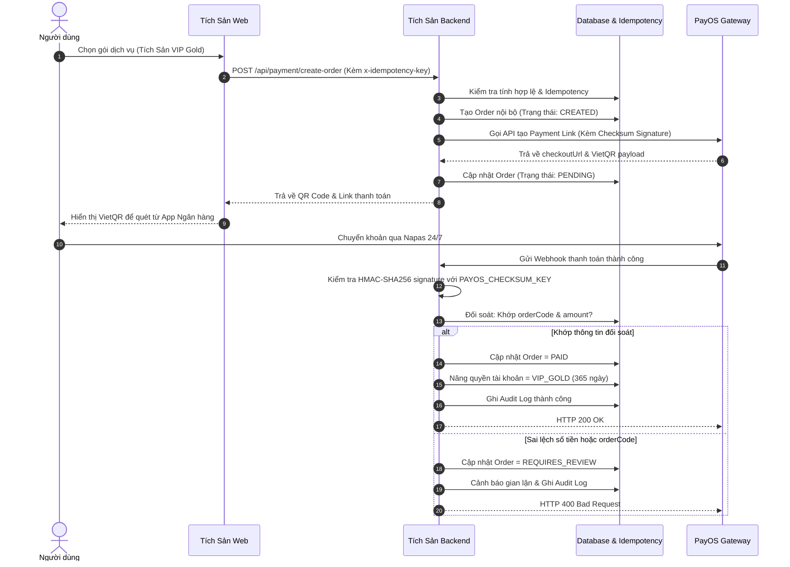

# QUY TRÌNH THANH TOÁN & ĐỐI SOÁT PAYOS (PAYMENT FLOW SPECIFICATION) — TÍCH SẢN

Tài liệu này quy định chi tiết luồng thanh toán gói dịch vụ, cổng kiểm soát pháp lý và cơ chế đối soát hai chiều giữa **Tích Sản** và cổng thanh toán **PayOS**.

---

## 1. Cổng Kiểm Soát Pháp Lý (Legal Compliance Gate)

Theo các quy định pháp luật hiện hành tại Việt Nam:
- **Luật Quản lý Thuế số 149/2025/QH15**.
- **Nghị định 70/2025/NĐ-CP** về hóa đơn, chứng từ điện tử khi cung cấp dịch vụ số.
- **Quy định bảo vệ dữ liệu cá nhân (Nghị định 13/2023/NĐ-CP)**.

Hệ thống thiết lập bộ 3 biến cờ bắt buộc:
```ini
PAYMENTS_ENABLED=false
PAYOS_ENABLED=false
LEGAL_COMPLIANCE_APPROVED=false
```

### 1.1. Hành vi khi Cổng Pháp Lý Tắt (`false` - Mặc định)
- Khi người dùng bấm **Chọn gói này** trên bất kỳ gói trả phí nào:
  1. Frontend gọi `/api/payment/create-order`.
  2. Backend phát hiện `LEGAL_COMPLIANCE_APPROVED=false`.
  3. Trả về thông báo:
     > *"Tính năng thanh toán trực tuyến hiện chưa được mở. Tích Sản đang hoàn thiện các điều kiện pháp lý, thuế và hóa đơn liên quan trước khi triển khai. Bạn chưa phát sinh khoản thanh toán nào."*
  4. Hiển thị modal kèm **Mã QR Placeholder minh họa** (được làm mờ, có đóng dấu "QR MẪU — CHƯA KÍCH HOẠT THANH TOÁN").
  5. **Tuyệt đối không** sinh link PayOS thật, **không** trừ tiền người dùng, **không** tự ý nâng cấp gói.

---

## 2. Luồng Thanh Toán Khi Cổng Pháp Lý Được Kích Hoạt (`true`)



---

## 3. Máy Trạng Thái Đơn Hàng (Order State Machine)

Hệ thống quản lý trạng thái thanh toán qua các bước chuyển nghiêm ngặt:

| Trạng thái | Ý nghĩa | Quyền lợi gói |
| :--- | :--- | :--- |
| `CREATED` | Đơn hàng vừa được khởi tạo trong DB | Chưa cấp |
| `PENDING` | Đã sinh QR VietQR và gửi link cho khách | Chưa cấp |
| `PAID` | Đã nhận webhook hợp lệ và đối soát khớp số tiền 100% | **Đã kích hoạt** |
| `CANCELLED` | Người dùng hủy thao tác thanh toán | Không cấp |
| `EXPIRED` | Quá thời hạn thanh toán (15 phút) | Không cấp |
| `FAILED` | Giao dịch bị ngân hàng từ chối | Không cấp |
| `REFUNDED` | Đã hoàn trả tiền cho khách hàng | Thu hồi quyền lợi |
| `REQUIRES_REVIEW` | Sai lệch số tiền hoặc chữ ký nghi ngờ tấn công | Tạm khóa chờ can thiệp |

---

## 4. Kiểm Thử & Kịch Bản Ngoại Lệ

1. **Webhook trùng lặp (Duplicate Webhook)**: Nhờ cơ chế kiểm tra trạng thái trong DB, nếu webhook thứ hai gửi đến khi đơn hàng đã là `PAID`, hệ thống chỉ trả về `HTTP 200 OK` mà không nâng hạn gói lần hai.
2. **Sai số tiền (Amount Mismatch)**: Nếu khách hàng sửa số tiền chuyển khoản (ví dụ gói 999.000 ₫ chỉ chuyển 99.000 ₫), hệ thống lập tức chuyển sang `REQUIRES_REVIEW`, không nâng gói và ghi nhận log an ninh.
3. **Mất kết nối mạng**: Người dùng có thể quay lại trang Quản lý gói cước bất cứ lúc nào để kiểm tra trạng thái đơn hàng.

